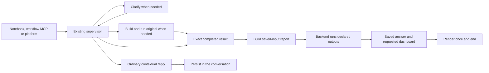

# Research, native reports and saved answers

This document covers SDK research, the explicit `epoch_sdk.workflow_mcp`
compatibility module and ordinary EpochAI conversations. The default composable
MCP uses the [caller-selected tools](public-client-interface.md): Codex or Claude
owns the reasoning and can answer directly without an Epoch supervisor or
publication requirement.

## Current research path

`EpochClient.run` presents the existing checkpointed research workflow. The
supervisor resolves data, settles material questions, builds and executes the
original study when needed, then reviews its actual result. Clarifications pause
and resume the same thread. An already completed result can be reused directly.

For computed answers, the supervisor authors a separate saved-input report over
the exact completed execution. The report uses native `execution_table`,
`sql_program` and transforms to compute the required facts, tables and JSON.
Optional bounded cached `llm_call` produces text for declared `response_text`,
Markdown or `executive_summary` sinks. Backend runs the report and saves its
declared outputs. Its confirmed receipt ends the turn; there is no final
publication tool, inner audit agent, dashboard editor or second assistant answer.
An original script never reads its own unfinished execution.

Ordinary platform discussion uses one concise reply persisted in the conversation
and needs no computation or native answer. For an accepted SDK request with one
text output and no current computation, study/source reference or execution
parameters, the normal final reply can be completed automatically through the
existing Backend answer API. This shortcut cannot replace failed or missing
computed outputs. Progress, questions and failures retain their own event paths.

An answer has its own `response_id`, query `request_id`, `thread_id` and immutable
revision `version`. It contains the requested named table, JSON and text parts.
Separate queries can use the same execution without overwriting earlier answers.
A completed SDK request pins its exact answer revision; later report changes or
manual revisions do not replace that read.

Execution-backed answers name their exact completed execution. A native report's
answer points to the report execution; its provenance retains the original source.
A later robustness or diagnostic run does not automatically displace the selected
source. Readers never choose a run by scanning for the latest successful ID. An
answer without an engine run omits execution/study references and has no
reusable-study handle.

## Independent response and dashboard sinks

A response table does not require a dashboard table, and requested dashboard-only
work creates no artificial answer. Preserve each declared output's name, type,
description and order. Tables bind complete native computed data and the accepted
Column schema: ordered columns, nullability, descriptions and units. Native and
requested guarantees are validated over every row. Rankings, filtering and
chronology are explicit native computations, not model-written row arrays or a
preview presented as the complete table. JSON is constructed from computed data;
the bounded text call does not enumerate table cells or manufacture financial JSON.

Dashboard sinks are independent and appear only when requested. The same declared
text producer can feed requested response and dashboard text destinations. A
published answer does not require another dashboard narrative or execution-summary
copy. Revisions over an existing generated dashboard use its explicit
`base_presentation` pin; conflicts with human edits stay visible. Native human
edit/Reset/share controls remain available.

For SDK research, native report admission carries `research_request_id`. Backend
confirms its immutable `native_execution_request_id` link before starting the
report. Reconnect waits for confirmed output completion and retains the answer
without another publication callback. `ResearchCompleted.request_id` identifies
the research attempt; `ResearchCompleted.response.request_id` retains the report's
native operation identity. Numerical execution status, `response_phase`, required
output failures and confirmed `extension_outputs` remain distinct.

## Reuse and replay

Both `EpochClient` and `AgentToolsClient` expose `extension_inputs`,
`save_extension`, `execute_extension`, `extension_status`, `response`,
`response_table` and `extension_presentation` over the native APIs. The default
MCP exposes the same extension lifecycle; the caller can write the program itself
without an authoring model.

An extension with explicit `input_tables` refines one immutable completed result
and never reruns that source. Select exact supported table/field enum references;
no join, source identity or missing relation is inferred. A first research answer
over an ordinary original study can also return `reusable_study` with
`SavedStudy.report_template`. Executing that prepared reference runs a new
original once, then its frozen report once, without a supervisor. The numerical
original and report child have separate IDs; answer and presentation pins belong
to the report. Native MCP replay uses the existing `epoch_execute_extension`
request with `report_template` instead of `input_tables`.

Original costs and declared parameter bindings remain captured. A new period
requires the report's explicit captured `allow_period_override` permission;
changing engine dates does not rewrite fixed SQL filters, fiscal labels or a
frozen roster. Replaying an existing historical response plan remains supported
through the explicit workflow API; new work uses native reports rather than
creating another plan language. See [historical plan compatibility](response-plans.md).

## Persistence, reads and ownership

Caller-chosen `operation_id` values reconnect SDK/MCP clients to the same accepted
research or prepared execution. Matching inputs attach; changed inputs conflict.
Reading status or reconnecting with the same accepted identity starts no work.
Client disconnection stops observation while server-owned admitted work continues.
Native run identities and operation-specific checkpoints retain pending questions
and failure observations across later conversation activity. This does not add
recovery workers, automatic retry policies or new retention guarantees. See
[readable reconnect](reconnect-operations.md).

New table answers carry saved-source references with no 10,000-row total-table
ceiling. Use `response_table` / `iter_response_table` on either client, or MCP
`epoch_read` with a table name, to read every page. Each page is bounded to 10,000
rows and 4 MiB; saved answer JSON is bounded to 4 MiB. Older inline-row answers
retain their saved order and remain readable. Invalid, ambiguous, incomplete or
oversized output fails explicitly. Schema validation does not certify analytical
correctness or prose compliance. See [table access](response-tables.md).

Current native routes:

| Owner | Surface |
| --- | --- |
| Backend | POST/GET/PATCH `/api/v1/integration/requests[/{requestId}]` |
| Backend | GET `/api/v1/integration/requests/by-handle/{operationId}` |
| Backend | POST/GET `/api/v1/integration/execution-requests[/{requestId}]` and GET `by-handle/{operationId}` |
| Backend | POST `/api/v1/research/requests/{requestId}/response` |
| Backend | GET `/api/v1/research/responses/{responseId}?version=...` |
| Backend | POST `/api/v1/studies/executions/{executionId}/response-tables` |
| LangGraph | Native state, run/wait and interrupt/resume |
| EpochSDK/MCP | Wrap native LangGraph and generated StratifyX clients |

The low-level native publication API remains available to direct application
integrations. It is not a model-facing supervisor tool and is not invoked again
after native report publication. Clients receive Epoch authentication and service
URLs; vendor/model credentials remain on the services. The current package uses
the normal generated StratifyX `>=3.3.0rc24,<4` dependency, not copied or edited
native models.

## Platform handoff and compatibility

`published_response` in graph state retains the source-owned `ResponseReference`.
A native report's confirmed receipt identifies its answer revision and requested
presentation pins. Render the referenced answer once in the query's conversation
card and use the report's associated dashboard output. Ordinary contextual replies
render from the persisted conversation. An answer without a primary execution
does not retarget the dashboard. Historical receipts remain readable for earlier
queries; they are not instructions to invoke a retired tool.

Keep loading/read failures visible and preserve the reference instead of selecting
a different answer. The illustrative combined `/v1/run` contract and historical
acceptance records remain prior design/evidence, not extra deployed proxies or
proof of a newer candidate. Automatic multi-study merging, recovery workers,
retention and custom presentation remain separate work.
