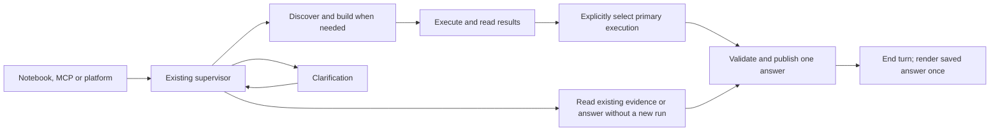

# One query, one published answer

The Python SDK, MCP and ordinary EpochAI conversations share the existing
checkpointed supervisor. Research and prepared-study execution remain separate
operations. Research submits a query, discovers/builds when necessary, reviews
actual results and publishes one answer. Questions pause the same thread.

An answer has its own `response_id`, query `request_id`, `thread_id` and immutable
revision `version`. It contains named table, JSON and text parts. Separate queries
can use the same execution without overwriting one another's answers. A completed
SDK request pins its exact answer and revision; later edits do not change that read.

Publication is the final supervisor tool and ends the turn without a second model
answer. A runtime policy rejects unpersisted final assistant answers. Ordinary
conversation defaults to concise Markdown named `answer`. SDK output declarations
remain exact. Progress, clarification and failure events keep their existing paths.

Execution-backed answers explicitly name a primary completed study run. A later
robustness/diagnostic execution does not automatically displace it. The reader never
chooses a successful execution by scanning for the latest ID. An answer without an
engine run omits execution/study references and has no reusable-study handle.

Authoring owns computations and complete persisted relations; the supervisor owns
the reviewed interpretation. Response tables do not require dashboard exhibits.
`inspect_response_sources` reads native saved-output metadata directly.
`ResponseTableSource` identifies an exact native DESCRIBE relation and physical
fields. Backend validates the complete projection and saves its reference; the model
supplies neither SQL nor rows. Clients read all rows in bounded pages. Bind native
`order_by` keys explicitly for requested rankings or chronology. JSON/text parts use
evidence the caller has read. Existing dashboard
exhibits may still serve the dashboard's own purpose. A response does not mandate
another dashboard Markdown narrative or execution-summary report.

Current native routes:

| Owner | Surface |
| --- | --- |
| Backend | POST/GET/PATCH `/api/v1/integration/requests[/{requestId}]` |
| Backend | GET `/api/v1/integration/requests/by-handle/{operationId}` |
| Backend | POST/GET `/api/v1/integration/execution-requests[/{requestId}]` and GET `by-handle/{operationId}` |
| Backend | POST `/api/v1/research/requests/{requestId}/response` |
| Backend | GET `/api/v1/research/responses/{responseId}?version=...` |
| Backend | POST `/api/v1/studies/executions/{executionId}/response-tables` |
| LangGraph | Native state, run/wait and interrupt/resume |
| EpochSDK/MCP | Wrap native LangGraph and generated StratifyX clients |

The public SDK and MCP share five operations: `run`, `execute`, `resume`,
`status` and `read`. A task string plus optional context, output declarations and
parameters goes through one session. Epoch owns discovery, building, output
validation and publication. See [the interface](public-client-interface.md).

Caller-chosen `operation_id` values reconnect SDK/MCP clients to the same accepted
research or prepared execution. Matching inputs attach; changed inputs conflict.
Backend publication pins the original answer without depending on a client
completion callback. Native run identities and operation-specific checkpoints
preserve pending questions and failure observations across later conversation
activity. See [readable reconnect](reconnect-operations.md) for notebook and MCP usage.

New table answers carry saved-source references, with no 10,000-row total-table
ceiling. Use `response_table` / `iter_response_table` on either client, or MCP
`epoch_read` with a table name, to read pages of up to 10,000 rows and 4 MiB. Saved answer
JSON remains bounded to 4 MiB. Older inline-row answers retain their saved order
and remain readable. See [table access](response-tables.md). Invalid, ambiguous,
incomplete or oversized output fails explicitly. Schema
validation does not certify analytical correctness or prose compliance.

## Platform handoff

`published_response` in graph state and the successful `publish_response` tool
receipt carry the same source-owned `ResponseReference`. Render that referenced
revision once in the query's conversation card, with the dashboard associated with
its primary execution. An answer without a primary execution does not retarget
the dashboard. Historical tool receipts preserve references for earlier
queries. Do not render a second final assistant narrative. Keep loading/read errors
visible and preserve the reference instead of silently substituting another answer.
Existing Markdown/table/JSON rendering is sufficient; custom cards and the research
tree belong to the new-design work.

The illustrative combined `/v1/run` contract remains historical design material;
no extra deployed proxy is introduced. Automatic multi-study merging, recovery
workers, retention, custom presentation and new response transforms remain deferred.
The user approved the structure review, and the local model/engine cases now pass
through the Python SDK and MCP. See [the verification record](verification-2026-10-18.md)
for the cases, error checks and rollout boundaries.
