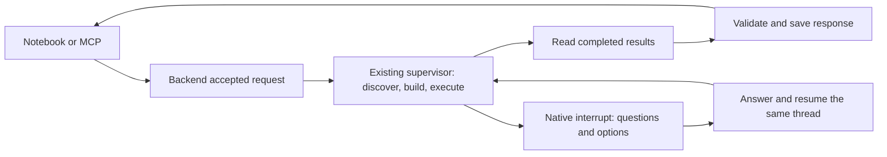

# Research through notebook SDK and MCP

`EpochClient.research` accepts the task, context, native parameters and named
table/JSON/text outputs. It saves that request in Backend, attaches a LangGraph
thread, then calls the existing EpochAI supervisor. This is separate from
`execute_saved`, which sends prepared work directly to Backend.



A complete research result contains the request ID, reusable study reference and
saved response. A response has named parts with their declarations and actual
values. Backend pins its execution and response version on the completed request.
A fresh client can read that same answer by request ID; no discovery or graph run
is started. A later response edit creates another revision without changing that
request's pinned answer.

```python
from epoch_sdk import RunRequest
from epoch_sdk.research import EpochClient, ResearchCompleted
from epoch_sdk.supervisor import NeedsInput

client = EpochClient.connect(
    graph_url=graph_url, backend_url=backend_url, token=token,
)
result = await client.research(RunRequest.model_validate({
    "task": "Explain annual sales for the selected companies",
    "context": ["Use the approved company selection and reporting basis"],
    "outputs": [{
        "name": "explanation", "type": "text", "format": "markdown",
        "instructions": "Explain the computed comparison, coverage and limitations",
    }],
}))
if isinstance(result, NeedsInput):
    print(result.feedback())
elif isinstance(result, ResearchCompleted):
    print(result.response.content.outputs)
    same_answer = await client.research_status(result.request_id)
```

Answer pending questions through `resume_research(waiting, responses)` using the
native `Answers` model, or continue in the existing Epoch UI and read
`research_status(request_id)`. The same thread retains discovery/build state.
Recommendations are shown as advice; the client does not choose answers.

MCP exposes these same operations as `epoch_research`, `epoch_resume_research`
and `epoch_research_status`. `epoch_execute_saved` is the separate direct
prepared-study action. `EpochClient.execution` / `epoch_execution` read its native
status by execution ID without an agent call. `epoch_response` and
`epoch_publish_response` also let a
researcher read or revise an answer after analysis without invoking the supervisor.
The older `epoch_run`/`epoch_resume` communication tools remain available and do
not promise named-output conformance on their own.

The supervisor's publication tool reads complete requested table artifacts itself.
The model supplies JSON/text interpretations using evidence it has read. Names,
types, ordered columns, descriptions, units and JSON Schema are checked. Factual
truth and compliance with prose instructions still depend on the research, not
schema validation. Oversized results fail explicitly: the prototype accepts at
most 4 MiB per response and 10,000 rows per table.

Actual REST ownership is explicit:

| Service | Calls used by research |
| --- | --- |
| Backend | POST/GET/PATCH `/api/v1/integration/requests[/{requestId}]`; existing study/execution/dashboard calls; POST/GET `/api/v1/studies/executions/{executionId}/response` |
| LangGraph | Native thread state, run/wait and interrupt/resume through LangGraph SDK |
| EpochSDK | Orchestrates those two clients; MCP wraps these methods |

Backend #480 generates the native OpenAPI and StratifyX 3.3.0rc1 package. The
illustrative combined `/v1/run` binding in `contracts/openapi.json` is historical
design material, not an additional deployed proxy. The Python research operation
above is the current prototype surface. Discovery and execution remain in their
owning services.

Component tests verify transport, native controller/storage behavior and the
supervisor publication helper. They do not establish a real research run. The
user's structure-review gate still applies before model/engine integration runs.
Recovery workers, automatic retries, retention and new response transforms remain
outside this prototype.
